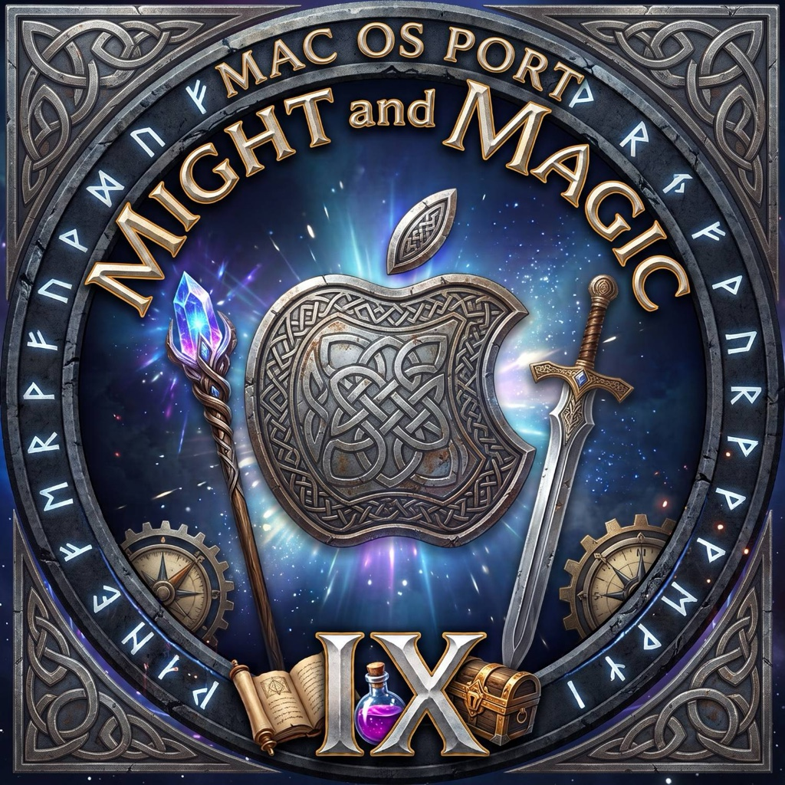
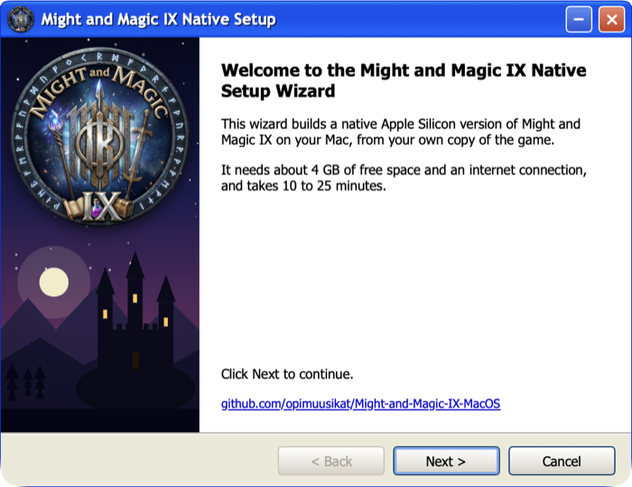
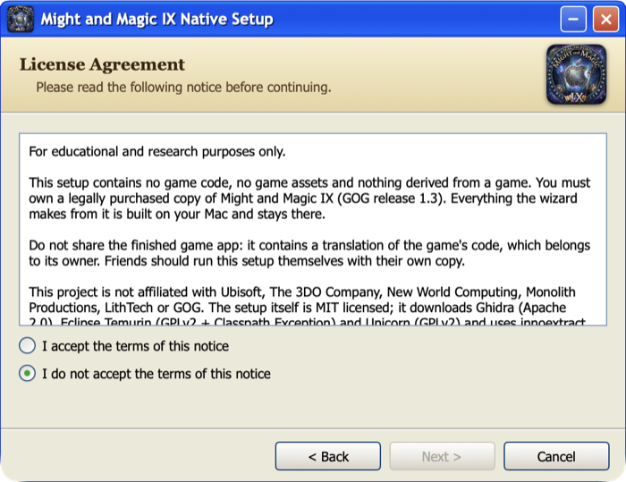
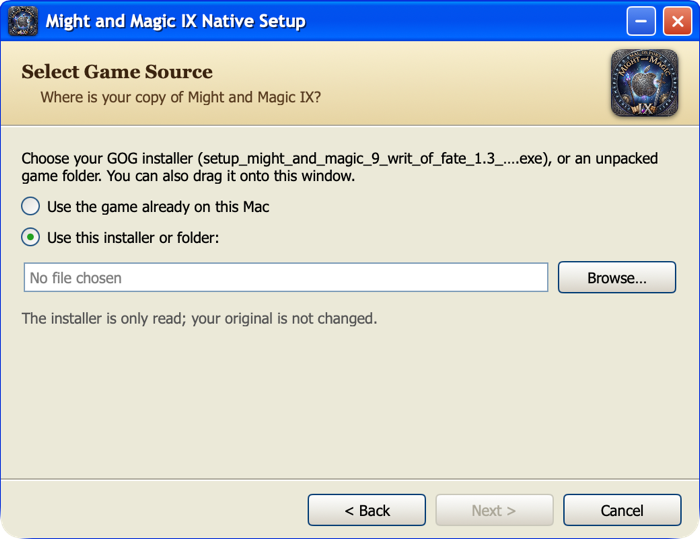
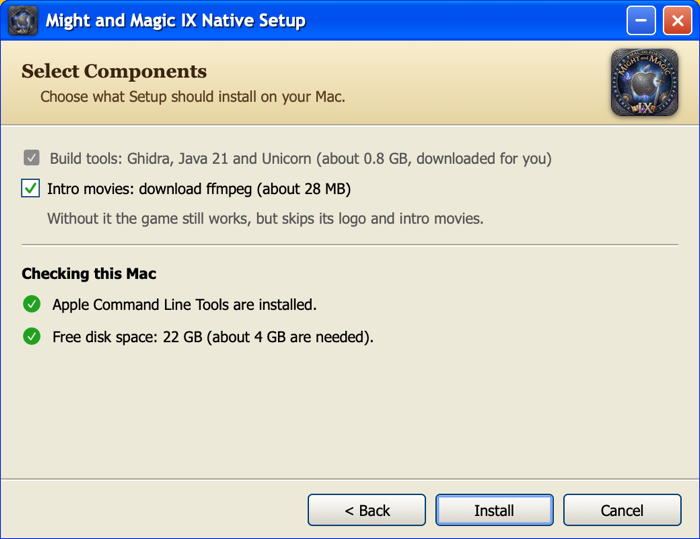
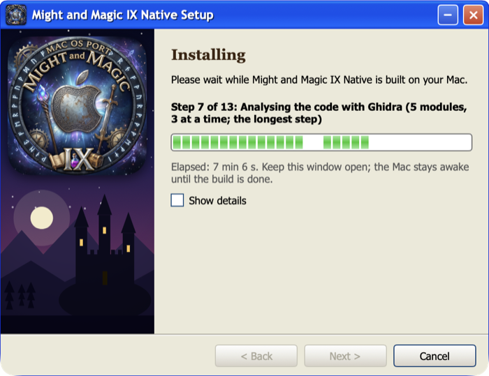
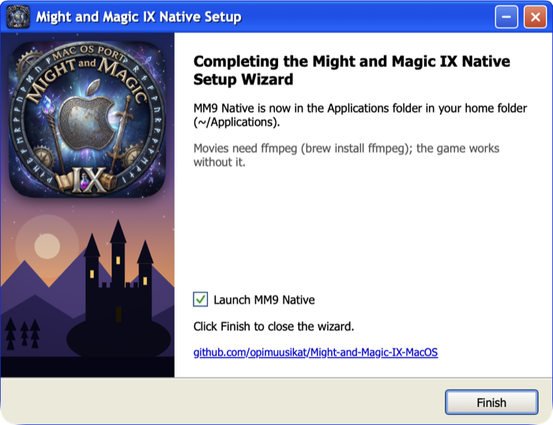
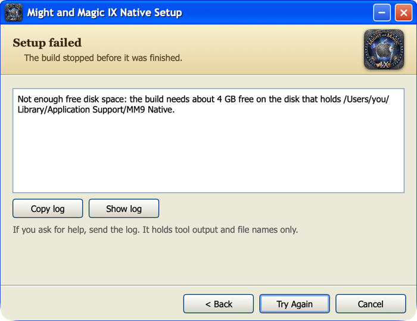

<p align="center"></p>

# Might-and-Magic-IX-MacOS: bring-your-own-game native build of Might and Magic IX for Apple Silicon

Translates the machine code of Might and Magic IX (2002, LithTech engine, 32-bit Windows) into C
that compiles natively for Apple Silicon (arm64). The result runs on a native host: Win32 shims,
DirectDraw 7 / Direct3D 7 on Metal, the Miles Sound System API on CoreAudio, DirectInput from
Cocoa, and Bink movies through the `ffmpeg` tool. No Wine, no Rosetta.

> **This project is for educational and research purposes only.**
>
> **This repository does not contain any game code, game assets or anything derived from a game.
> You must provide your own legally purchased copy of Might and Magic IX (GOG release 1.3) to use
> it.** Nothing here works without one, and everything the builder produces from it stays on your
> Mac. Piracy is not supported; please do not ask for or share game files, or the app the builder
> makes.

> **Made entirely with AI.** All the code here (the recompiler, the native host, the builder and the
> installer), the documentation and the logo were produced with AI. The code and docs were written
> by Claude through Claude Code, with a person directing the work and testing the game. Treat it
> as an experiment and expect rough edges.

## How to install (step by step, for everyone)

You do **not** need to know anything about computers or programming. Just follow the steps in order.
It takes about 5 to 30 minutes, and most of that is the computer working by itself.

### Before you start: check three things

1. **You must own the game.** This project does not contain the game. You need your own copy of
   **Might and Magic IX (Writ of Fate) from GOG.com**, version **1.3**. Buying it on
   [gog.com](https://www.gog.com) is the only legal way to get it.
2. **Your Mac must have an Apple chip (M1, M2, M3, M4 or newer).** Click the Apple logo in the top left
   corner, then **About This Mac**. If it says **Chip: Apple M…**, you are fine. If it says
   **Processor: Intel**, this will not work on your Mac.
3. **Your Mac needs macOS 13 or newer, about 4 GB of free space and internet.** The same "About This Mac"
   window shows the macOS version.

### Step 1: Download your game installer from GOG

1. Log in to [gog.com](https://www.gog.com) and open **Your library** → **Might and Magic IX**.
2. Find **Download offline backup game installers** and choose the **Windows** version.
3. Download the file whose name starts with `setup_might_and_magic_9_writ_of_fate_1.3_…` and ends with
   `.exe`. It lands in your **Downloads** folder. *(You will not run it. The installer below reads it for
   you. Do not worry that it is a Windows file.)*
4. If GOG gives you more than one file (for example also a `.bin` file), keep **all** of them together in
   the same folder.

### Step 2: Download the installer app

1. Open the [**Releases** page](https://github.com/opimuusikat/Might-and-Magic-IX-MacOS/releases/latest).
2. Under **Assets**, click **`MM9-Native-Installer.dmg`** to download it.
3. Open the downloaded `.dmg` file by double-clicking it (it is in your **Downloads** folder). A small
   window opens with the **MM9 Native Installer** app in it.
4. Drag **MM9 Native Installer** onto the **Applications** folder in that window. Then you can close the
   window.

### Step 3: Open the installer app (the first time, macOS is cautious)

The app is not signed by Apple (that costs money), so macOS first says it "cannot verify" it. That is
normal. This project is open source and you can read all of its code here.

- **Mac with macOS 15 (Sequoia) or newer:**
  1. Open **Applications** and double-click **MM9 Native Installer**. A message appears. Click **Done**
     (not "Move to Trash").
  2. Click the Apple logo → **System Settings** → **Privacy & Security**.
  3. Scroll all the way down. Next to the text about "MM9 Native Installer" click **Open Anyway**.
  4. Type your Mac password or use Touch ID, then click **Open Anyway** again.
- **Mac with macOS 14 or older:** open **Applications**, **hold the Control key and click** (or
  right-click) **MM9 Native Installer**, choose **Open**, then click **Open** again.

You only have to do this once. Next time it opens normally.

### Step 4: Follow the windows (it looks like an old Windows XP installer)

**1. Welcome.** Click **Next >**.

<p align="center"></p>

**2. Notice.** Read it, click **I accept the terms of this notice**, then **Next >**.

<p align="center"></p>

**3. Pick your game file.** Click **Browse…** and choose the `setup_might_and_magic_9_…exe` file from your
**Downloads** folder. (Shortcut: you can also drag the file onto the window.) Then click **Install**.

<p align="center"></p>

**4. Choose what to install.** Leave **Intro movies** ticked: Setup then downloads a small free tool
(ffmpeg, 28 MB) so the game can play its logo and intro movies. The page also checks your Mac: if
Apple's **Command Line Tools** are missing, click **Install…** and follow Apple's window (about 10 minutes,
no Apple ID needed); the page notices by itself when they are ready. Then click **Install**.

<p align="center"></p>

**5. Wait.** A green bar shows the progress. This takes about 3 minutes on a fast Mac and up to 25
minutes on an older one. **Keep the window open and do not close the lid.** You can tick **Show details**
if you are curious.

<p align="center"></p>

**6. Done.** When you see **Completing the Might and Magic IX Native Setup Wizard**, click **Finish**.
The game starts if the box **Launch MM9 Native** is ticked.

<p align="center"></p>

If something goes wrong, you see this window instead. Read the message in the box, fix it, and click
**Try Again** (see the table below):

<p align="center"></p>

### Step 5: Play

The game is now installed as **MM9 Native** in the **Applications** folder **inside your home folder**:
in Finder click **Go** in the top menu → **Home**, then open the **Applications** folder. Drag it to
your Dock to start it quickly next time.

- **Ctrl + Cmd + F:** full screen on and off. **Cmd + Esc:** frees the mouse. **Cmd + Q:** quit.
- **Intro movies:** if you left **Intro movies** ticked in Setup, they play. If not, the game still works
  and just skips them. (To add them later, run Setup again with the box ticked, or install
  [Homebrew](https://brew.sh) and type `brew install ffmpeg` in the Terminal app.)
- **Your saves** are in `~/Library/Application Support/MM9 Native/game/SaveGames`.

> **Do not share the finished game with anyone.** It contains the game's own code, which belongs to its
> owner. A friend who wants it should follow these same steps with their own GOG copy.

### How to update

If a newer version of this project comes out, you do not have to start over. The **updater** looks at what
you have and brings it up to date. Your game copy, saved games and settings stay.

1. Open the [**Releases** page](https://github.com/opimuusikat/Might-and-Magic-IX-MacOS/releases/latest) and
   download **`MM9-Native-Updater.dmg`**.
2. Open it and start **MM9 Native Updater** the same way as the installer (Step 2 and Step 3 above; macOS is
   cautious the first time).
3. Click **Next >**. The updater shows what it found: your MM9 Native, which version built it, the game
   copy and your saves, the tools, and your Mac. It also says what will be updated and why.
4. Click **Next >** again, leave the boxes as they are, and click **Update**. This takes a few minutes, up to
   25 on an older Mac. Keep the window open.
5. Click **Finish**. Before it changes anything, the updater copies your saved games to
   `~/Library/Application Support/MM9 Native/backups`. If the update fails, your old MM9 Native is left as it was.

### Something went wrong?

| What you see | What to do |
|---|---|
| macOS says the app "can't be opened" or "is damaged" | Do Step 3 again (Open Anyway / right-click → Open). |
| "This Mac does not have Apple Silicon" | Your Mac has an Intel chip. This does not work on Intel Macs. |
| "…is not the expected version" or "does not look like the GOG installer" | You need the **GOG** version **1.3**. A Steam copy, a disc copy or an older GOG version will not work. Download the newest installer from your GOG library. |
| "Not enough free disk space" | Free up about 4 GB (empty the Trash, delete old downloads) and click **Try Again**. |
| "The build stopped at step …" | Click **Try Again**. If it fails again, click **Copy log** and [open an issue](https://github.com/opimuusikat/Might-and-Magic-IX-MacOS/issues) and paste the log there. The log contains only tool output and file names. |
| You closed the window by accident | Open the installer again and choose **Use the game already on this Mac**. It continues from where it was. |

Questions or problems? Please [open an issue](https://github.com/opimuusikat/Might-and-Magic-IX-MacOS/issues)
or visit the maintainer's GitHub profile: [github.com/opimuusikat](https://github.com/opimuusikat).

## Status

**Might and Magic IX runs natively on Apple Silicon macOS.** The builder translates all five code
modules ahead of time (20,000 functions in `lithtech.exe`, `d3d.ren`, `cshell.dll`, `object.lto`
and `clientfx.fxd`).

What works:
- **Playing:** main menu, new game, party creation, the 3D world, save and load (with thumbnails),
  native fullscreen, settings that persist.
- **Sound and movies:** music and sound effects, and the intro movies with sound (if `ffmpeg` is
  installed).
- **Graphics options:** Options → Video Options has extra rows: Resolution (up to 4x internal
  resolution), Anti-aliasing, Sharp Textures, Smooth Mipmaps, HD Textures and Frame Rate (60/120).
  Cmd+, opens the same settings as a panel over the game. You can also make your own AI-upscaled HD
  texture pack from your copy of the game; it is for your own use only. See
  [docs/ENHANCEMENTS.md](docs/ENHANCEMENTS.md).
- **Speed:** the game holds its 60 fps cap at up to about 2,100 draws per frame. The same game
  under Wine on the same Mac manages about 23 fps. At the first training-area view, the native
  engine needs about 1 ms of main-thread time per frame; Wine needs about 43 ms.

How the translation is checked: in differential tests against the original x86 in the Unicorn
emulator, 8,774 of 8,816 testable entry points (99.5 %) match the original exactly, flags included.

Not done yet:
- **Long play sessions:** not tested.
- **Intel Macs:** the builder refuses to run on them. For Intel Macs, use the Wine version of the
  game.

## Build it (from the command line)

Requirements:
- **The Mac:** Apple Silicon and macOS 13 or later.
- **Apple's Command Line Tools** (`xcode-select --install`). No Xcode and no Apple ID needed.
  Homebrew is needed only for `brew install innoextract` if you start from the GOG installer
  (`.exe`) instead of an unpacked game folder or the Wine app's copy; `brew install ffmpeg` is
  optional (movies).
- **Your own GOG copy of Might and Magic 9 (Writ of Fate), version 1.3.** The builder checks the
  SHA-256 of the five code modules.
- **About 4 GB of free disk space and an internet connection.** The builder downloads Ghidra 12.1.4,
  a Temurin Java 21 runtime and the Unicorn 2.1.4 library once (0.8 GB). Each download is checked
  against a fixed SHA-256.

```bash
git clone https://github.com/opimuusikat/Might-and-Magic-IX-MacOS.git
bash Might-and-Magic-IX-MacOS/src/build.sh
```

Or double-click `Build MM9 Native.command`; [`README.txt`](README.txt) has the step-by-step for
players.

The builder looks for the game where the Wine version of the game puts it
(`~/Library/Application Support/Might and Magic IX/game`), or asks for the folder. It writes
`~/Applications/MM9 Native.app`. On a fast Apple Silicon Mac the whole build takes about 3.5 minutes; expect
10–25 minutes on a base M1 including the download.

Each build ends with a smoke test: the builder starts the new app once without a window and
requires it to reach the main menu. It also reports whether Ghidra's output and the final function
table are byte-identical to the reference build that was play-tested.

## How it works

1. **Check:** the builder verifies the five code modules of your game against fixed SHA-256s.
2. **Clone the game folder:** it makes an APFS clone of the folder. The game runs and saves there,
   so your original is never written.
3. **Rebase:** three of the DLLs are moved to distinct fixed addresses (`src/tools/rebase.py`), so
   that all five modules fit in one address space.
4. **Ghidra:** Ghidra analyses each module. The [Fallout-NV-MacOS](https://github.com/thetheoryofR/Fallout-NV-MacOS)
   repair passes find the remaining entry points, jump tables and no-return calls. `DumpPcode.java`
   then exports every function as P-code, Ghidra's small, precise intermediate language.
   (Ghidra's release zip lacks an Apple Silicon build of its decompiler, which the jump-table
   recovery needs, so the builder compiles one from the zip's sources.)
5. **Emit C:** `src/recomp/emit_rc.py` translates the P-code into C over a register file and a 4 GB
   guest address space (`src/recomp/rt.h`). It honours the x87 rounding mode, which the game's
   float-to-int conversions depend on.
6. **Compile and link:** clang compiles the C (about 21,800 functions), and the builder links it
   with one guest-address dispatch table and the host runtime in `src/host`.
7. **Package:** everything is wrapped into an ad-hoc signed app bundle, with an icon made from your
   copy's own GOG icon.

The host runtime (`src/host`, about 5,000 lines of C and Objective-C) provides:
- **The module loader:** it maps the five rebased modules and serves the game's own
  LoadLibrary/GetProcAddress calls.
- **kernel32/user32/gdi32 shims.**
- **DirectDraw 7 + Direct3D 7 on Metal:** one ubershader, DXT and 16-bit textures, colour-keyed
  blits and back-buffer readback.
- **Miles on CoreAudio:** 2D/3D samples and MP3 streams.
- **DirectInput from Cocoa.**
- **Bink through ffmpeg:** the movies are decoded by the `ffmpeg` command-line tool; nothing from
  FFmpeg is linked.
- **A safety net:** an embedded Unicorn interpreter runs any code the analysis missed (nine small
  init-time routines at start-up).

The full engineering notes, with measurements, are in [`docs/RECOMP-NOTES.md`](docs/RECOMP-NOTES.md).

## Bring your own game

- **Only your copy.** The builder needs the GOG 1.3 release. It reads your copy and makes
  everything game-derived on your Mac: the rebased modules, Ghidra projects, P-code dumps,
  generated C, objects, the binary and the app. Nothing of it is uploaded anywhere.
- **Do not share the app it makes.** It contains a translation of the game's code, which belongs to
  its owner. Friends run the builder themselves.
- **Guards against committing game files:**
  - The `.githooks/pre-commit` guard refuses executables, DLLs and the game's module types, Ghidra
    projects, P-code dumps, generated C and files over 1 MB. Enable it with
    `git config core.hooksPath .githooks`.
  - `dev/leak_check.py` scans a folder for any run of 127 or more bytes copied from your game's
    files.

## Repository layout

| path | what |
|---|---|
| `Build MM9 Native.command`, `README.txt` | double-click entry point and player instructions |
| `src/build.sh`, `src/manifest.sh` | the builder; pinned hashes and tool downloads |
| `src/host/` | the native host runtime |
| `src/recomp/` | `rt.h`, the emitter and flag-liveness pass (from Fallout-NV-MacOS, with fixes) |
| `src/ghidra_scripts/` | the Fallout-NV-MacOS Ghidra scripts used by the build |
| `src/tools/` | rebase, dispatch-table merge, icon tools |
| `installer/` | the Windows XP style installer app (SwiftUI) and its logo |
| `dev/` | maintainer tools: packaging with a leak check, building the installer app and `.dmg`, source sync |
| `docs/img/` | screenshots for this README |
| `docs/RECOMP-NOTES.md` | feasibility study, milestones and measurements |

## Prior art and credits

- **Who did the work:** the code, the documentation and the logo were made by AI. Claude
  (Anthropic), through Claude Code, wrote the recompiler changes, the native host, the builder, the
  installer and these docs; the commits name the model that wrote each one. The maintainer,
  [opimuusikat](https://github.com/opimuusikat), chose the goal, wrote the prompts, reviewed the
  results, play-tested the game and decides what gets published. That is directing and testing,
  not writing the code.
- **[Fallout-NV-MacOS](https://github.com/thetheoryofR/Fallout-NV-MacOS)** (MIT, thetheoryofR):
  the P-code lifter, the emitter, the Ghidra repair passes and the first version of several host
  files. This project uses a patched emitter: it honours the x87 rounding control and treats
  FFREE as a no-op.
- **[NFSU2Recomp](https://github.com/TalhaMudo/NFSU2Recomp)** was read as a reference for Win32 API
  coverage.
- **The bring-your-own-game model:** N64Recomp, XenonRecomp and ReXGlue established the
  bring-your-own-game model for static recompilation.
- **Tools downloaded by the builder:**
  - [Ghidra](https://github.com/NationalSecurityAgency/ghidra) (Apache 2.0);
  - [Eclipse Temurin](https://adoptium.net/) (GPLv2 with Classpath Exception);
  - [Unicorn](https://www.unicorn-engine.org/) (GPLv2; linked only into the app built on your Mac,
    which is never distributed).

## Legal

This is an unofficial, non-commercial project made for education and research into static
recompilation. It is not affiliated with, endorsed by or sponsored by Ubisoft, The 3DO Company,
New World Computing, Monolith Productions, LithTech or GOG. Might and Magic is a trademark of its
respective owner, used here only to describe compatibility.

No game code, assets or generated output are or will be distributed through this repository or
its releases. Buy the game to use this project.

## Licence

MIT; see [`LICENSE`](LICENSE). It covers this repository's code only, not any game. Parts are
derived from Fallout-NV-MacOS (MIT); see [`LICENSES/`](LICENSES).
